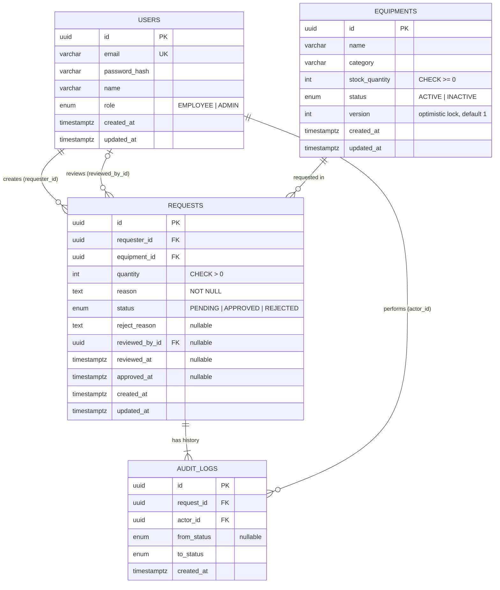
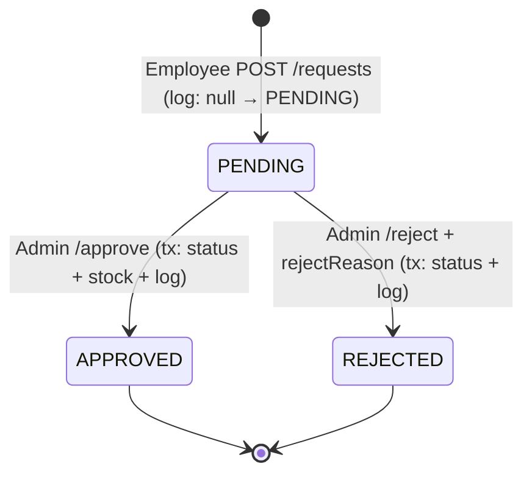

# Checkpoint 1.2 — IT Equipment Request System: ER Diagram & API Design

Oct 15, 2026 · เวอร์ชัน 1.2 (source of truth ของโปรเจกต์; §3, §4.1, §4.3 และ §6 ปรับให้ตรงกับ Phase 2.2)

## 0. ข้อสังเกตและจุดที่ปรับจากโจทย์

ออกแบบตาม SRS ทุกข้อ แต่มี 8 จุดที่เพิ่มหรือตีความเกินจาก brief เพราะถ้าทำตามตัวอักษรจะมีช่องโหว่หรือไม่ครบตาม docs

| # | ประเด็น | ตัดสินใจ | เหตุผล |
| --- | --- | --- | --- |
| 1 | Brief ไม่มี field เวลาอนุมัติ | เพิ่ม `approved_at`, `reviewed_by_id` ใน Requests | SRS 2.3 สั่ง "บันทึกเวลาที่อนุมัติ" ตรงๆ ไม่ควรพึ่ง AuditLog อย่างเดียว |
| 2 | Transaction อย่างเดียวไม่กัน race condition | ใช้ conditional update (`WHERE status='PENDING'` และ `WHERE stock_quantity >= qty`) + DB CHECK `stock_quantity >= 0` | Admin 2 คนกดพร้อมกัน หรืออนุมัติ 2 คำขอของอุปกรณ์เดียวกัน จะอ่าน stock ค่าเก่าแล้วหักซ้ำได้ ทั้งที่อยู่ใน transaction (Read Committed) |
| 3 | Reject ก็เขียน 2 ตาราง | ครอบ transaction ด้วย (update + AuditLog) | โจทย์บังคับเฉพาะ Approve แต่ถ้า Reject สำเร็จแต่ log พัง จะผิดข้อ "ทุกครั้งที่เปลี่ยนสถานะต้องบันทึก" |
| 4 | การสร้างคำขอนับเป็นการเปลี่ยนสถานะไหม | บันทึก AuditLog `from_status = NULL → PENDING` ตอนสร้าง | ได้ประวัติครบตั้งแต่ต้น จึงให้ `from_status` เป็น nullable |
| 5 | ฝั่ง Admin ไม่มีการลบอุปกรณ์ | ไม่ทำ DELETE ใช้ `status = INACTIVE` แทน, FK เป็น `ON DELETE RESTRICT` | Requests อ้างอิงอุปกรณ์ ลบจริงจะทำประวัติหาย |
| 6 | เช็ค stock ตอนสร้างคำขอ | เช็ค `ACTIVE`, `stock > 0`, `quantity <= stock` แต่เป็น soft check; ตัวตัดสินจริงคือตอน Approve | คำขอ PENDING หลายใบรวมกันเกิน stock ได้ เพราะยังไม่ตัดสต็อก (ตาม SRS) |
| 7 | 1 คำขอ = กี่อุปกรณ์ | 1 คำขอ = 1 อุปกรณ์ (ไม่ทำ RequestItems) | SRS เขียน "เลือกอุปกรณ์ ระบุจำนวน" เป็นเอกพจน์ และทำให้ approve ทั้งใบไม่ต้องมี partial approval |
| 8 | สถานะคำขอเปลี่ยนได้อย่างไร | แยก endpoint `/approve` กับ `/reject` ไม่ทำ `PATCH {status}` แบบเปิด | บังคับทางเดินเดียว PENDING → APPROVED/REJECTED; สถานะสุดท้ายแก้ไม่ได้ |

นอกขอบเขต (ไม่อยู่ใน SRS จึงไม่ทำ): Register, Employee ยกเลิกคำขอ, คืนอุปกรณ์, ตาราง Categories แยก (ใช้ `category` เป็น string)

## 1. ER Diagram

4 ตาราง, ทุก FK เป็น many-to-one; Requests เป็นศูนย์กลางที่ผูก Users (2 บทบาท: ผู้ขอ/ผู้อนุมัติ), Equipments และ AuditLogs



## 2. Relations, Constraints และ Indexes

| Relation | Cardinality | FK / onDelete | ความหมาย |
| --- | --- | --- | --- |
| Users → Requests (requester) | 1 : N | `requests.requester_id` NOT NULL, RESTRICT | พนักงาน 1 คนสร้างได้หลายคำขอ |
| Users → Requests (reviewer) | 0..1 : N | `requests.reviewed_by_id` NULL, RESTRICT | Admin ที่อนุมัติ/ปฏิเสธ; เป็น NULL ขณะ PENDING |
| Equipments → Requests | 1 : N | `requests.equipment_id` NOT NULL, RESTRICT | 1 คำขออ้างอุปกรณ์ 1 ชิ้น |
| Requests → AuditLogs | 1 : N (อย่างน้อย 1) | `audit_logs.request_id` NOT NULL, RESTRICT | ทุกคำขอมี log อย่างน้อยตอนสร้าง |
| Users → AuditLogs (actor) | 1 : N | `audit_logs.actor_id` NOT NULL, RESTRICT | ใครเป็นคนทำรายการ |

ทุก FK เป็น RESTRICT เพราะข้อมูลเป็นหลักฐานการเบิก ไม่ควร cascade หายไปพร้อมกัน; AuditLogs เป็น append-only (ไม่มี endpoint update/delete)

**Enums (Prisma):** `Role { EMPLOYEE ADMIN }`, `EquipmentStatus { ACTIVE INACTIVE }`, `RequestStatus { PENDING APPROVED REJECTED }` — AuditLogs ใช้ `RequestStatus` ตัวเดียวกัน

**Constraints ที่ Prisma schema เขียนไม่ได้** → เพิ่มเองในไฟล์ migration (`prisma migrate dev --create-only` แล้วแก้ SQL):

```sql
ALTER TABLE equipments ADD CONSTRAINT chk_stock_non_negative CHECK (stock_quantity >= 0);
ALTER TABLE requests   ADD CONSTRAINT chk_quantity_positive  CHECK (quantity > 0);
ALTER TABLE requests   ADD CONSTRAINT chk_reject_reason
  CHECK (status <> 'REJECTED' OR (reject_reason IS NOT NULL AND length(trim(reject_reason)) > 0));
```

**Indexes:**

| Index | ใช้กับ |
| --- | --- |
| `users(email)` UNIQUE | Login |
| `requests(status, created_at DESC)` | Admin กรองสถานะ + เรียงใหม่สุด + pagination |
| `requests(requester_id, created_at DESC)` | ประวัติคำขอของฉัน |
| `requests(equipment_id)` | join / ค้นหาตามอุปกรณ์ |
| `audit_logs(request_id, created_at)` | timeline ของคำขอ |
| `equipments(status)` | รายการอุปกรณ์ฝั่ง Employee |

ค้นหาด้วย `ILIKE` บนชื่ออุปกรณ์/ชื่อผู้ขอเพียงพอสำหรับขนาดข้อมูลนี้; ถ้าโตมากค่อยเพิ่ม `pg_trgm` GIN index

ชื่อใน Prisma ใช้ camelCase (`stockQuantity`) + `@map("stock_quantity")` และ `@@map("equipments")` เพื่อให้ DB เป็น snake_case ตรงตามเอกสาร

## 3. Auth & Guard

ใช้ JWT (Bearer) ไม่ใช่การจำลอง header เพราะ header ปลอม role ได้ ซึ่งขัดกับข้อ "ป้องกันสิทธิ์ระดับ API"

- **Token:** payload `{ sub: userId, role }`, อายุ 1 ชม. (ไม่ทำ refresh token เพราะนอก scope); password เก็บเป็น bcrypt hash (cost 10)
- **JwtAuthGuard แบบ global** (`APP_GUARD`) — ทุก route ต้อง login เว้นที่ติด `@Public()` (มีแค่ `POST /auth/login`) → ลืมใส่ guard แล้วไม่หลุด
- **RolesGuard แบบ global** — อ่าน `@Roles(Role.ADMIN)` จาก metadata; ไม่ตรง → `403 Forbidden`
- **Role ต้องมาจาก DB หรือ token ที่ server เซ็น** ไม่เชื่อค่าจาก body/query
- **Ownership check (ใน service):** Employee เรียก `GET /requests/:id` ของคนอื่น → `404` (ไม่ใช้ 403 เพื่อไม่เปิดเผยว่า id มีอยู่จริง)
- **`requester_id` มาจาก `req.user.sub` เสมอ** ไม่รับจาก body
- **Validation:** `ValidationPipe({ whitelist: true, forbidNonWhitelisted: true, transform: true })` + class-validator ทุก DTO; `ParseUUIDPipe` กับทุก `:id`
- **Login rate limit:** นับเฉพาะการ login ที่ล้มเหลว (รหัสผิด/ไม่พบ email) ต่อ email (แปลงเป็นตัวพิมพ์เล็ก) เกิน 10 ครั้งใน 15 นาที (ตั้งค่าได้ด้วย env) → `429 TOO_MANY_REQUESTS` พร้อม header `Retry-After`; login สำเร็จล้างตัวนับของ email นั้น; จำกัดต่อ IP เพิ่มเฉพาะเมื่อตั้ง `TRUST_PROXY` เพราะผ่าน BFF IP ที่ API เห็นคือ Next server (Next ต้องส่ง `X-Forwarded-For` ต่อ); เก็บในหน่วยความจำ (รีสตาร์ตแล้วหาย) พอสำหรับ instance เดียว

**Frontend = BFF (Backend-for-Frontend):** token อยู่ใน httpOnly cookie ซึ่ง JS ฝั่ง browser อ่านไม่ได้ จึงไม่ให้ browser เรียก NestJS ตรง

- `POST /api/auth/login` (Next.js Route Handler) เรียก NestJS `/auth/login` แล้ว set cookie `access_token` (`httpOnly`, `secure` ใน prod, `sameSite=lax`, `maxAge` 1 ชม.) และ **ส่งกลับไปแค่ `{ user }` ห้ามส่ง `accessToken` ต่อให้ browser** ไม่งั้น httpOnly ไม่มีความหมาย (token ไปอยู่ใน JS memory/devtools ได้)
- ทุก call ไป NestJS วิ่งผ่าน Server Component / Server Action / Route Handler ที่อ่าน cookie แล้วแนบ `Authorization: Bearer` ให้ (`lib/api.ts` ฝั่ง server ตัวเดียว)
- NestJS รับแค่ Bearer ไม่ต้องอ่าน cookie, ไม่ต้องเปิด CORS ให้ browser; `sameSite=lax` + mutation ผ่าน Server Action/POST พอสำหรับ CSRF ในขอบเขตนี้
- Token หมดอายุ (ไม่มี refresh): `middleware.ts` ตรวจ `exp` ด้วย `jose` (`ERR_JWT_EXPIRED`) → ลบ cookie แล้ว redirect `/login?expired=1`; ส่วน `401` ที่ `lib/api.ts` เจอ (เกิดได้เฉพาะกรณีอื่น เช่น secret ไม่ตรงกัน) → `redirect('/api/auth/logout?expired=1')` ให้ Route Handler เป็นคนลบ cookie เพราะ Next 15 แก้ cookie ใน Server Component ไม่ได้
- `middleware.ts` redirect ตาม role จาก cookie — เป็นแค่ UX ด่านจริงคือ guard ฝั่ง NestJS
- `middleware.ts` รันบน **Edge runtime** ซึ่งใช้ `jsonwebtoken` ไม่ได้ (พึ่ง Node `crypto`) จึงใช้ `jose` (`jwtVerify` + `JWT_SECRET` เดียวกับ NestJS) ในการ verify/decode token แล้วอ่าน `role` จาก payload

**Seed users** (ใส่ใน README):

| Email | Password | Role |
| --- | --- | --- |
| admin@company.com | Admin@123 | ADMIN |
| employee1@company.com | Employee@123 | EMPLOYEE |
| employee2@company.com | Employee@123 | EMPLOYEE |

มี employee 2 คนเพื่อทดสอบว่าคนหนึ่งเห็นคำขออีกคนไม่ได้; seed คำขอ 15 รายการคละสถานะ PENDING/APPROVED/REJECTED และคละผู้ขอ พร้อม AuditLog ที่สอดคล้องกัน (เกิน limit 10 จึงเห็น pagination หน้า 2 ทันที, stock ของอุปกรณ์สะท้อนคำขอที่ APPROVED แล้ว) ในนั้นมีคำขอ PENDING 2 รายการไว้สาธิต 409: รายการหนึ่งบนอุปกรณ์ที่ INACTIVE (→ EQUIPMENT_INACTIVE) และอีกรายการที่ quantity เกิน stock ปัจจุบัน (→ INSUFFICIENT_STOCK) — seed insert ตรงลง DB จึงข้าม validation ตอนสร้างได้ เหมือนสถานการณ์จริงที่สถานะ/stock เปลี่ยนหลังสร้างคำขอ; seed อุปกรณ์ประมาณ 8 รายการ รวมกรณี `stock = 0` และ `INACTIVE` อย่างละ 1 เพื่อทดสอบเงื่อนไข

## 4. API Endpoints

13 endpoints, prefix `/api/v1`, ทุก route ต้องมี `Authorization: Bearer <token>` ยกเว้น login

### 4.1 Auth

| Method | Path | Role | Body / Query | Response |
| --- | --- | --- | --- | --- |
| POST | `/auth/login` | Public | `{ email, password }` | `200 { accessToken, user: { id, name, email, role } }` / `401` / `429` — นี่คือ response ของ NestJS; Next.js Route Handler ส่งต่อให้ browser แค่ `{ user }` (ดู §3) |
| GET | `/auth/me` | Any | — | `200 { id, name, email, role }` |

### 4.2 Equipments

| Method | Path | Role | Body / Query | Response |
| --- | --- | --- | --- | --- |
| GET | `/equipments` | Any | `?search&category&status&page&limit` | `200 Paginated<Equipment>` — Employee ได้เฉพาะ `ACTIVE` (server บังคับ, ไม่สน `status` query) |
| GET | `/equipments/categories` | Any | — | `200 string[]` (distinct category, ใช้ทำ dropdown กรอง) — Employee ได้เฉพาะหมวดของอุปกรณ์ที่ ACTIVE, Admin ได้ทุกหมวด |
| GET | `/equipments/:id` | Any | — | `200 Equipment` / `404` (Employee เห็น INACTIVE → 404) |
| POST | `/equipments` | ADMIN | `{ name, category, stockQuantity, status? }` | `201 Equipment` |
| PATCH | `/equipments/:id` | ADMIN | `{ version, name?, category?, stockQuantity?, status? }` — **`version` บังคับ** | `200 Equipment` / `409 VERSION_CONFLICT` ถ้ามีคนแก้หรือ approve ไปก่อน |

### 4.3 Requests

| Method | Path | Role | Body / Query | Response |
| --- | --- | --- | --- | --- |
| POST | `/requests` | EMPLOYEE | `{ equipmentId, quantity, reason }` | `201 Request` (status `PENDING`) / `422` ถ้า stock 0 หรือ quantity > stock / 404 ถ้าอุปกรณ์ไม่มีหรือ INACTIVE |
| GET | `/requests/me` | EMPLOYEE | `?status&page&limit` | `200 Paginated<Request>` เฉพาะของตัวเอง |
| GET | `/requests` | ADMIN | `?status&search&page&limit&sort` | `200 Paginated<Request>` — `search` หาในชื่ออุปกรณ์ OR ชื่อผู้ขอ |
| GET | `/requests/:id` | Any (+ ownership) | — | `200 RequestDetail` (รวม `auditLogs[]`) / `404` |
| PATCH | `/requests/:id/approve` | ADMIN | — | `200 Request` / `404` ถ้าไม่พบคำขอ / `409` ถ้าไม่ใช่ PENDING (`INVALID_STATUS`) หรือ stock ไม่พอ (`INSUFFICIENT_STOCK`) หรืออุปกรณ์ถูกปิดใช้งาน (`EQUIPMENT_INACTIVE`) |
| PATCH | `/requests/:id/reject` | ADMIN | `{ rejectReason }` | `200 Request` / `404` ถ้าไม่พบคำขอ / `409` ถ้าไม่ใช่ PENDING (`INVALID_STATUS`) |

`/requests/me` ต้องประกาศก่อน `/requests/:id` ใน controller ไม่งั้น `me` จะถูกจับเป็น `:id` (แต่ `ParseUUIDPipe` ก็กันได้อีกชั้น)

### 4.4 Validation (DTO)

| DTO | Field | Rule |
| --- | --- | --- |
| LoginDto | email / password | `@IsEmail()` / `@IsString() @MinLength(6)` |
| CreateEquipmentDto | name | `@IsString() @Transform(trim) @Length(1, 120)` |
| | category | `@IsString() @Transform(trim) @Length(1, 60)` |
| | stockQuantity | `@IsInt() @Min(0) @Max(100000)` — กัน int overflow |
| | status | `@IsOptional() @IsEnum(EquipmentStatus)` — **ไม่ใส่ default ใน DTO** ให้ Prisma `@default(ACTIVE)` จัดการ |
| UpdateEquipmentDto | ทุก field | `PartialType(CreateEquipmentDto)` — ต้องมีอย่างน้อย 1 field นอกจาก `version` |
| | version | `@IsInt() @Min(1)` — **บังคับ** (optimistic lock) |
| CreateRequestDto | equipmentId | `@IsUUID()` |
| | quantity | `@IsInt() @Min(1) @Max(100)` — กัน 0, ติดลบ, ทศนิยม |
| | reason | `@IsString() @Transform(trim) @Length(5, 500)` |
| RejectRequestDto | rejectReason | `@IsString() @Transform(trim) @Length(5, 500)` |
| PaginationQuery | page / limit | `@Type(() => Number) @IsInt() @Min(1)` default 1 / `@Type(() => Number) @IsInt() @Min(1) @Max(100)` default 10 — query string มาเป็น string |
| | search | `@IsOptional() @IsString() @Transform(trim) @MaxLength(100)` |
| EquipmentQuery | category | `@IsOptional() @IsString() @MaxLength(60)` |
| | status | `@IsOptional() @IsEnum(EquipmentStatus)` (ADMIN เท่านั้นที่มีผล) |
| RequestQuery | status | `@IsOptional() @IsEnum(RequestStatus)` |
| | sort | `@IsOptional() @IsIn(['createdAt:desc', 'createdAt:asc'])` default `createdAt:desc` — whitelist แล้ว map เป็น `orderBy` เอง ไม่ส่งชื่อฟิลด์จาก client เข้า Prisma ตรงๆ |

```typescript
// common/transforms.ts — trim แบบปลอดภัย: ค่าที่ไม่ใช่ string ส่งต่อให้ @IsString() ตีตกเป็น 400 แทนที่จะ throw TypeError เป็น 500
export const trim = ({ value }: TransformFnParams) => (typeof value === 'string' ? value.trim() : value);

// schema.prisma
model Equipment {
  status  EquipmentStatus @default(ACTIVE)
  version Int             @default(1)
  // ...
}
```

**ทำไมไม่ใส่ `status = ACTIVE` ใน `CreateEquipmentDto`:** `PartialType` copy property initializer ไปที่ `UpdateEquipmentDto` ด้วย พอ `transform: true` สร้าง instance ใหม่ field `status` จะได้ค่า `ACTIVE` เองแม้ client ไม่ได้ส่ง → `PATCH` แก้แค่ stock จะเปิดอุปกรณ์ INACTIVE กลับเป็น ACTIVE โดยไม่ตั้งใจ จึงย้าย default ไปที่ DB

**`UpdateEquipmentDto` ต้องมีอย่างน้อย 1 field:** body `{ version }` อย่างเดียวจะ bump version โดยไม่เปลี่ยนอะไรและทำให้ admin คนอื่นได้ 409 ฟรีๆ จึงตอบ `400 VALIDATION_ERROR` (เช็คใน `update()` ดู 5.1)

### 4.5 Response types (ใช้ร่วม FE/BE)

```typescript
type Role = 'EMPLOYEE' | 'ADMIN';
type EquipmentStatus = 'ACTIVE' | 'INACTIVE';
type RequestStatus = 'PENDING' | 'APPROVED' | 'REJECTED';

interface UserSummary { id: string; name: string; email: string; role: Role }

interface Equipment {
  id: string; name: string; category: string;
  stockQuantity: number; status: EquipmentStatus; version: number;
  createdAt: string; updatedAt: string;
}

interface EquipmentRequest {
  id: string; quantity: number; reason: string; status: RequestStatus;
  rejectReason: string | null;
  approvedAt: string | null; reviewedAt: string | null;
  requester: Pick<UserSummary, 'id' | 'name'>;
  reviewer: Pick<UserSummary, 'id' | 'name'> | null;
  // stockQuantity + status: admin เห็นก่อนกดว่าสต็อกพอ/อุปกรณ์ถูกปิดหรือไม่ → UI ปิดปุ่ม Approve และขึ้นป้ายเตือนได้
  equipment: Pick<Equipment, 'id' | 'name' | 'category' | 'stockQuantity' | 'status'>;
  createdAt: string;
}

interface AuditLog {
  id: string; fromStatus: RequestStatus | null; toStatus: RequestStatus;
  actor: Pick<UserSummary, 'id' | 'name'>; createdAt: string;
}

interface RequestDetail extends EquipmentRequest { auditLogs: AuditLog[] }

interface Paginated<T> {
  data: T[];
  meta: { page: number; limit: number; total: number; totalPages: number };
}
```

## 5. Approve / Reject Transaction

Approve = 3 คำสั่งใน `prisma.$transaction` เดียว ทุกคำสั่งเป็น conditional update ที่ตรวจเงื่อนไขใน `WHERE` เอง; ถ้าตัวไหน update ได้ 0 แถว → throw → rollback ทั้งหมด



```typescript
// requests.service.ts
async approve(id: string, adminId: string): Promise<EquipmentRequest> {
  return this.prisma.$transaction(async (tx) => {
    const req = await tx.request.findUnique({ where: { id } });
    if (!req) throw new NotFoundException({ code: 'NOT_FOUND', message: 'Request not found' });

    // 1) ล็อกสถานะ: อัปเดตได้เฉพาะตอนยัง PENDING (กัน double-approve)
    const now = new Date();
    const updated = await tx.request.updateMany({
      where: { id, status: 'PENDING' },
      data: { status: 'APPROVED', approvedAt: now, reviewedAt: now, reviewedById: adminId },
    });
    if (updated.count === 0)
      throw new ConflictException({ code: 'INVALID_STATUS', message: 'Request is not PENDING' });

    // 2) หักสต็อกแบบ atomic: ต้อง ACTIVE และพอหัก + bump version (ให้ optimistic lock ของ PATCH /equipments รู้ว่าค่าเปลี่ยน)
    const stock = await tx.equipment.updateMany({
      where: { id: req.equipmentId, status: 'ACTIVE', stockQuantity: { gte: req.quantity } },
      data: { stockQuantity: { decrement: req.quantity }, version: { increment: 1 } },
    });
    if (stock.count === 0) {
      // อ่านซ้ำเพื่อแยกสาเหตุให้ FE แสดงข้อความถูก (throw → rollback ขั้น 1 อยู่แล้ว)
      const eq = await tx.equipment.findUniqueOrThrow({ where: { id: req.equipmentId } });
      throw eq.status !== 'ACTIVE'
        ? new ConflictException({ code: 'EQUIPMENT_INACTIVE', message: 'Equipment is inactive' })
        : new ConflictException({ code: 'INSUFFICIENT_STOCK', message: `Only ${eq.stockQuantity} left` });
    }

    // 3) Audit log ผ่าน service แยก (ทดสอบ rollback ด้วย jest.spyOn ได้)
    await this.auditLog.log(tx, { requestId: id, actorId: adminId, from: 'PENDING', to: 'APPROVED' });

    return tx.request.findUniqueOrThrow({ where: { id }, include: requestInclude });
  });
}

// audit-log.service.ts — รับ tx เข้ามา จึงอยู่ใน transaction เดียวกับผู้เรียก
log(tx: Prisma.TransactionClient, e: { requestId: string; actorId: string; from: RequestStatus | null; to: RequestStatus }) {
  return tx.auditLog.create({ data: { requestId: e.requestId, actorId: e.actorId, fromStatus: e.from, toStatus: e.to } });
}
```

**ทำไมทางนี้ปลอดภัย:**

- `UPDATE … WHERE status = 'PENDING'` ทำให้ PostgreSQL ล็อกแถวนั้น; Admin คนที่ 2 ที่กดพร้อมกันจะรอ แล้ว re-check เจอสถานะ APPROVED → count 0 → 409
- `decrement` + `gte` คือ `SET stock = stock - qty WHERE stock >= qty` คำสั่งเดียว ไม่มีช่วง read-then-write ให้ค่าเก่าหลุด
- CHECK `stock_quantity >= 0` เป็นตาข่ายชั้นสุดท้ายถ้าโค้ดผิด
- ไม่ต้องใช้ `SERIALIZABLE` — Read Committed (default) พอ เพราะเงื่อนไขอยู่ใน `UPDATE` ทั้งหมด

**Reject** ใช้โครงเดียวกันแต่ไม่มีขั้น 2: `updateMany({ where: { id, status: 'PENDING' }, data: { status: 'REJECTED', rejectReason, reviewedAt, reviewedById } })` + `auditLog.create` ใน transaction เดียวกัน

**Create request** ก็ครอบ transaction (insert request + insert AuditLog `null → PENDING`)

**ทดสอบ rollback (e2e):** `tx` ใน interactive transaction เป็น client ใหม่ mock ตรงๆ ยาก จึงใช้ `jest.spyOn(auditLogService, 'log').mockRejectedValueOnce(new Error())` → ตรวจว่า request ยัง PENDING และ stock/version ไม่เปลี่ยน; และยิง approve 2 คำขอพร้อมกันด้วย `Promise.all` ที่รวมกันเกิน stock → ต้องสำเร็จแค่ 1 อีกอันได้ `409 INSUFFICIENT_STOCK`

**INACTIVE ระหว่างรอ:** approve ไม่ได้ (`409 EQUIPMENT_INACTIVE`) และไม่ auto-reject คำขอ PENDING ตอน admin ปิดอุปกรณ์ ให้ admin reject เองพร้อมเหตุผล; UI ขึ้นป้าย "อุปกรณ์ถูกปิดใช้งาน" ที่คำขอนั้น (ใช้ `equipment.status` ใน response)

### 5.1 Optimistic lock สำหรับแก้สต็อก (`PATCH /equipments/:id`)

Admin แก้ stock เป็นค่าสัมบูรณ์ จึงต้องกัน lost update: ส่ง `version` ที่เห็นตอนเปิดฟอร์มมาด้วย ถ้าไม่ตรง → 409

```typescript
// equipments.service.ts
async update(id: string, dto: UpdateEquipmentDto): Promise<Equipment> {
  const { version, ...data } = dto;
  if (Object.values(data).every((v) => v === undefined))
    throw new BadRequestException({ code: 'VALIDATION_ERROR', message: 'At least one field besides version is required' });
  const res = await this.prisma.equipment.updateMany({
    where: { id, version },
    data: { ...data, version: { increment: 1 } },
  });
  if (res.count === 0) {
    const exists = await this.prisma.equipment.findUnique({ where: { id }, select: { id: true } });
    if (!exists) throw new NotFoundException({ code: 'NOT_FOUND', message: 'Equipment not found' });
    throw new ConflictException({ code: 'VERSION_CONFLICT', message: 'ข้อมูลอุปกรณ์ถูกแก้ไขระหว่างนี้ กรุณาโหลดใหม่' });
  }
  return this.prisma.equipment.findUniqueOrThrow({ where: { id } });
}
```

**จุดที่ห้ามลืม: approve ต้อง bump `version` ด้วย** (ขั้น 2 ด้านบน) ไม่งั้น lock ไม่มีผลกับกรณีที่ตั้งใจกัน: admin A เปิดฟอร์มเห็น stock 5 (v3) → admin B approve 2 ชิ้น stock เหลือ 3 แต่ยัง v3 → A บันทึก stock 10 ผ่าน ทั้งที่ตัดสินใจจากตัวเลขเก่า

FE เจอ `409 VERSION_CONFLICT` → refetch แล้วแสดงค่าล่าสุดในฟอร์มพร้อมข้อความ ไม่ใช่แค่ toast error

## 6. Error Format และคำถามที่ขอยืนยัน

ทุก error คืนรูปเดียวผ่าน global `HttpExceptionFilter` เพื่อให้ Frontend ทำ Error State ได้จาก type เดียว:

```json
{ "statusCode": 409, "error": "Conflict", "message": "Only 2 left", "code": "INSUFFICIENT_STOCK" }
```

| Status | เมื่อไหร่ | `code` |
| --- | --- | --- |
| 400 | DTO validation ไม่ผ่าน (`message` เป็น array) | `VALIDATION_ERROR` |
| 401 | ไม่มี/token หมดอายุ, login ผิด (FE: middleware หรือ `/api/auth/logout` ลบ cookie → `/login`) | `UNAUTHORIZED` |
| 403 | Role ไม่พอ (Employee เรียก endpoint Admin) | `FORBIDDEN` |
| 404 | ไม่พบ, ไม่ใช่เจ้าของคำขอ, หรือ Employee สร้างคำขอกับอุปกรณ์ INACTIVE | `NOT_FOUND` |
| 409 | คำขอไม่ใช่ PENDING (approve/reject) | `INVALID_STATUS` |
| 409 | stock ไม่พอตอน approve | `INSUFFICIENT_STOCK` |
| 409 | อุปกรณ์ถูกปิดใช้งานตอน approve | `EQUIPMENT_INACTIVE` |
| 409 | `version` ไม่ตรงตอนแก้อุปกรณ์ | `VERSION_CONFLICT` |
| 422 | สร้างคำขอกับอุปกรณ์ที่ stock 0 / quantity เกิน stock | `EQUIPMENT_UNAVAILABLE` |
| 429 | login ล้มเหลวเกินกำหนด (มี header `Retry-After`) | `TOO_MANY_REQUESTS` |
| 500 | error ที่ไม่ได้คาดไว้ (message กลางๆ ไม่ส่ง stack ให้ client, log ฝั่ง server พร้อม request id) | `INTERNAL_ERROR` |

Service ทุกตัว throw ด้วย `new XxxException({ code, message })` เสมอ เพื่อให้ filter มี `code` ส่งต่อ; exception ที่ไม่มี code (เช่นจาก ValidationPipe) filter เติมจาก status ให้

**INACTIVE ตอนสร้างคำขอ = 404 ไม่ใช่ 422:** ให้ตรงกับ `GET /equipments/:id` ที่ Employee เห็น INACTIVE เป็น 404 อยู่แล้ว ถ้าตอบ 422 จะยืนยันว่า id นั้นมีอยู่จริงทั้งที่ endpoint อ่านซ่อนไว้ ส่วน stock 0 / เกิน stock ยังเป็น 422 เพราะ Employee เห็นอุปกรณ์และ stock อยู่แล้ว (ฝั่ง service ใช้ query เดียว `findFirst({ where: { id, status: 'ACTIVE' } })` → null = 404)

**ข้อสรุปจากการรีวิว (ยืนยันแล้ว):**

- ถ้าอุปกรณ์ถูกตั้งเป็น INACTIVE หลังมีคำขอ PENDING แล้ว Admin approve ได้ไหม? → ไม่ได้ (409 EQUIPMENT_INACTIVE), ไม่ auto-reject คำขอตอนปิดอุปกรณ์ ให้ admin reject เองพร้อมเหตุผล, UI ขึ้นป้ายเตือน (ดู 5)
- Admin สร้างคำขอเบิกเองได้ไหม? → ไม่ได้ — `@Roles(EMPLOYEE)` บน `POST /requests` (กันอนุมัติคำขอตัวเองด้วย)
- แก้ stock เป็นค่าสัมบูรณ์หรือส่วนต่าง? → ค่าสัมบูรณ์ + optimistic lock ด้วย `version` และ approve ต้อง bump version ด้วย (ดู 5.1)
- Bonus: ทำ `docker-compose.yml` (db + api + web) ก่อน เพราะช่วยทีมรันตรวจได้ทันที

**เพิ่มได้ถ้ามีเวลา (ไม่บังคับใน SRS):**

- **Attachments:** ตาราง `request_attachments(id, request_id, file_name, mime_type, size, path)`; การเขียนไฟล์ไม่อยู่ใน DB transaction จึงเขียนไฟล์ก่อน → insert ใน transaction → ถ้า transaction ล้มให้ลบไฟล์ทิ้ง; validate mime type (whitelist รูป/PDF) และขนาด (เช่น ≤ 5 MB) ที่ server ไม่เชื่อนามสกุลไฟล์
- **`stock_adjustments(id, equipment_id, actor_id, from_qty, to_qty, created_at)`** บันทึกทุกครั้งที่ admin แก้ stock ใน transaction เดียวกับ update (ถ้าทำ ต้องครอบ `update()` ใน 5.1 ด้วย `$transaction` และอ่าน `from_qty` ก่อน update — ดูโค้ดด้านล่าง) — SRS บังคับ audit แค่สถานะคำขอ แต่โจทย์เน้นความถูกต้องของสต็อก
- **`approved_at` ซ้ำกับ `reviewed_at`** ตอน approve: ตั้งใจเก็บเพราะ SRS ระบุ "บันทึกเวลาที่อนุมัติ" ตรงๆ ส่วน `reviewed_at` ใช้ร่วมกับ reject; ถ้าต้องการ normalize ตัด `approved_at` แล้ว derive จาก `reviewed_at` + status ได้

```typescript
// equipments.service.ts — update() เวอร์ชันที่มี stock_adjustments
async update(id: string, dto: UpdateEquipmentDto, actorId: string): Promise<Equipment> {
  const { version, ...data } = dto;
  if (Object.values(data).every((v) => v === undefined))
    throw new BadRequestException({ code: 'VALIDATION_ERROR', message: 'At least one field besides version is required' });

  return this.prisma.$transaction(async (tx) => {
    // อ่าน from_qty ก่อน update; ถ้า version ยังตรงตอน update แปลว่า stock ไม่ถูกแตะระหว่างนี้
    // (approve bump version ทุกครั้ง) from_qty จึงเป็นค่าที่ถูกแทนที่จริง
    const before = await tx.equipment.findUnique({ where: { id }, select: { stockQuantity: true } });
    if (!before) throw new NotFoundException({ code: 'NOT_FOUND', message: 'Equipment not found' });

    const res = await tx.equipment.updateMany({ where: { id, version }, data: { ...data, version: { increment: 1 } } });
    if (res.count === 0)
      throw new ConflictException({ code: 'VERSION_CONFLICT', message: 'ข้อมูลอุปกรณ์ถูกแก้ไขระหว่างนี้ กรุณาโหลดใหม่' });

    if (data.stockQuantity !== undefined && data.stockQuantity !== before.stockQuantity) {
      await tx.stockAdjustment.create({
        data: { equipmentId: id, actorId, fromQty: before.stockQuantity, toQty: data.stockQuantity },
      });
    }
    return tx.equipment.findUniqueOrThrow({ where: { id } });
  });
}
```
